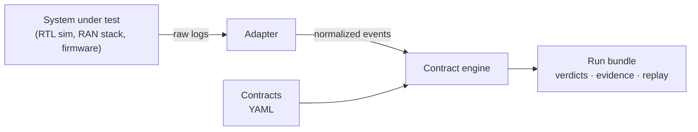

# CrossLayer

[](https://github.com/Pranav-s79/Cross-Layer-Systems-Test-Platform/actions/workflows/ci.yml)


**Cross-stack verification for systems built by many teams.**

Components often pass their own tests and still fail together, because the
bugs live *between* them: missed deadlines, silently dropped data, mismatched
assumptions. CrossLayer lets you write those cross-boundary expectations as
**contracts**, run controlled **experiments** (including fault injection),
and get **verdicts backed by evidence** that link straight to the raw log line.



## Quick start

```sh
pip install -e ".[dev]"

crosslayer run experiments/reference/baseline.yaml            # PASS
crosslayer run experiments/reference/fault_silent_drop.yaml   # FAIL, with evidence
crosslayer compare runs/<baseline> runs/<faulty>              # regression diff
```

```text
verdict   FAIL
events    800 (fingerprint 0654f85f7b561e31)
faults    silent_drop

  FAIL         pipeline.rx_accounted          397/400 triggers answered within 5 ms; 3 violations, 0 unresolved
  PASS         pipeline.packet_lifecycle      397 transitions across 400 entities; 0 illegal
  ...
  FAIL         pipeline.counter_conservation  held for 0/1 events
```

Every violation in the generated `report.md` points to its source, for
example `raw_artifacts/sim.log#L315`.

## Writing a contract

```yaml
- id: pipeline.rx_accounted
  title: Every received packet is processed or explicitly dropped within 5 ms
  owner: firmware-rx
  source: sensor_rx
  destination: proc
  evidence: [{event_type: system.halt}]   # truncated log -> INCONCLUSIVE, not FAIL
  rule:
    kind: response
    trigger: {event_type: packet.received}
    response: [{event_type: packet.processed}, {event_type: packet.dropped}]
    correlate_by: packet
    within_ms: 5
```

Six rule kinds cover deadlines, state machines, percentile thresholds,
invariants, and step-to-step relations such as `PC + 4`.
→ [Contract language](docs/contract-language.md)

## What works today

- **Pluggable adapters:** any system plugs in through one interface,
  discovered via entry points. The core never imports a target, and a test
  enforces that.
- **Contract engine:** six rule kinds, a sandboxed expression language, and
  PASS / FAIL / INCONCLUSIVE verdicts with no vacuous passes.
- **Reproducible runs:** seeded experiments, hashed run bundles, a replay
  script, and identical-seed repeatability checks.
- **CI-ready:** JUnit output, meaningful exit codes, and run-to-run regression diffs.
- **Validated with fault injection:** a reference pipeline with four injected
  faults. Each one is caught by exactly the contracts designed for it, and the
  baseline stays clean.

> The reference system is a deterministic **simulation** used to validate the
> core. It is not real firmware.

## Roadmap

CrossLayer grows from this verified core toward a production verification
platform:

| Stage | Phases | Status |
|---|---|---|
| Foundation | Verification core · contract tooling | ✅ Phase 1 done |
| Real integrations | RV32I RTL · 5G RAN/core logs · live 5G · firmware HIL | 🔜 next |
| Diagnosis | Fault localization · guided experiments · learning-assisted triage | 📋 planned |
| Scale | Streaming engine · results store · distributed execution | 📋 planned |
| Production | Platform service · OpenTelemetry · security and governance | 📋 planned |

→ [Full roadmap with exit criteria](ROADMAP.md)

## Documentation

| | |
|---|---|
| [Architecture](docs/architecture.md) | Layers, data flow, enforced boundaries |
| [Contract language](docs/contract-language.md) | Fields, selectors, rule kinds, expressions, verdicts |
| [Writing an adapter](docs/writing-an-adapter.md) | Connect a new system under test |
| [Run bundle format](docs/run-bundle.md) | What every run records and how to verify it |

## Development

```sh
python -m venv .venv && . .venv/bin/activate   # Windows: .venv\Scripts\activate
pip install -e ".[dev]"
pytest
python benchmarks/bench_core.py
```

Exit codes: `0` pass · `1` fail/regression · `2` inconclusive · `3` error · `4` config error
